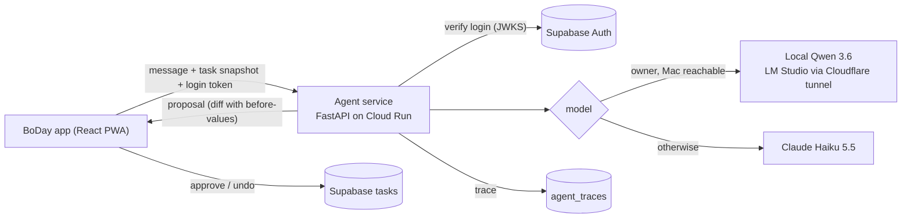

# BoDay

A task and routine manager (installable PWA) with a natural-language **AI
agent** that proposes changes to your tasks, which you approve or undo. The
agent comes with an **eval harness** that measures how reliable it is.

**Live:** https://boday.boapps.workers.dev (invite-only).

## The agent in one paragraph

You type "move my dentist to tomorrow" or "is my week realistic?". The agent
reads a snapshot of your tasks through 9 typed tools, then either proposes a
diff (each change carries its old values, so it can be checked and undone),
asks a clarifying question with options, or answers. **It cannot write
anything itself**: every change is applied by the app, only after you approve
it. A 102-case eval suite measures success, damage, guessing, injection
resistance, cost and latency across models, and every prompt change is a
logged experiment with before/after numbers.

## Results

Default model: **Claude Haiku 5.5**, prompt `3d211bac54ec`.

| | Baseline | After iteration |
|---|---|---|
| Dev success (3 trials, 95% CI) | 91.7% (87.4–94.6) | **99.6%** (97.6–99.9) |
| Holdout success (cases the prompt was not tuned on) | 91.7% | **95.8%** |
| Severe damage (a wrong change that would hurt if approved) | 2.6% | **0%** |
| Guessing on ambiguous requests | 23.1% | **0%** |
| Prompt-injection attack success | 0% | 0% |
| Cost / latency per request | $0.0009 / 3.5 s p50 | **$0.0008** / 3.5 s p50 |

- **Cross-model:** Sonnet 5.5 matched Haiku's baseline (92.1%) at 17× the
  cost, so Haiku is the default. A local Qwen 3.6 35B on a Mac reached 77%
  once its thinking mode was turned off (timeouts 25 → 0, p95 90 s → 6.5 s),
  but it does not follow the prompt rules that fixed Haiku.
- **What moved the number:** a failure analysis of the baseline found five
  clusters; four short prompt rules (ask through the tool, never partly do an
  over-limit request, search before creating, advice never proposes) fixed
  ten cases and broke none.
- **What did not:** a fix for a bug found in production improved the holdout
  but caused a regression on dev, so it was rejected and logged.
- **The judge was checked too:** the LLM judge for advice answers agreed with
  hand-checked scores only 31% of the time; it had never been shown the
  completion history. Fixed, it agrees 69% exactly and 100% within one point.

Full numbers, per-category tables and the experiment history:
[agent/README.md](agent/README.md#results-baseline-prompt-d2df24e4bee1) and
[agent/evals/ITERATION_LOG.md](agent/evals/ITERATION_LOG.md).

## How it works



- **Agent** ([agent/](agent/)): Python, a plain tool-use loop (no framework),
  9 tools, provider-agnostic (Anthropic or any OpenAI-compatible server).
  Hard limits per proposal (25 changes, 3 deletes); a tool can only touch a
  task id the agent has already read.
- **Evals** ([agent/evals/](agent/evals/)): 102 cases (77 dev, 25 holdout)
  across 11 categories including prompt injection through shared tasks,
  graded deterministically; advice answers also scored 1–5 by an LLM judge
  that is calibrated against hand-checked reference scores. Recorded
  cassettes replay 10 cases in CI on every push with no model calls.
- **Service** ([agent/boday_agent/server/](agent/boday_agent/server/)):
  FastAPI on Cloud Run (scales to zero, free tier). Supabase JWT auth, users'
  own API keys encrypted with AES-GCM, an SSRF guard for custom model URLs,
  traces in Postgres through an insert-only role.
- **App** ([src/](src/)): React 19 + TypeScript + Vite, Zustand, Supabase
  (RLS on every table), Cloudflare Workers. The chat shows each proposal as a
  diff card with approve, reject and undo.

## The app

- **Two task types:** one-time tasks carry over until done; recurring
  routines (daily, weekly, every N days, monthly) don't pile up, and
  completions are stored per date, which gives streaks and an honest history.
- **Calendar**, priorities P1–P4, carry-over badges, subtasks.
- **Push reminders** from a Cloudflare cron worker: on-time, re-nudges by
  priority, a 9 AM digest.
- **Shabbat and Yom Tov quiet mode:** pushes are suppressed between
  candle-lighting and havdalah (Hebcal), and recurring tasks can be skipped
  for a day.
- **Calendar feed** (.ics subscription), invite-only sign-up, offline-first.

## Run it

```bash
npm install && npm run dev        # app on http://localhost:5173
cd agent && uv sync && uv run pytest
uv run boday-eval run --provider anthropic --model claude-haiku-5-5 --split dev
```

The agent CLI, eval commands and deploy steps are in
[agent/README.md](agent/README.md) and [agent/DEPLOY.md](agent/DEPLOY.md).

## How it was built

Specs and plans are in [docs/superpowers/](docs/superpowers/). Each phase was
planned, built on its own branch by a coding agent, reviewed, and merged
through a PR; the paid eval runs and the deploy were done by hand.
